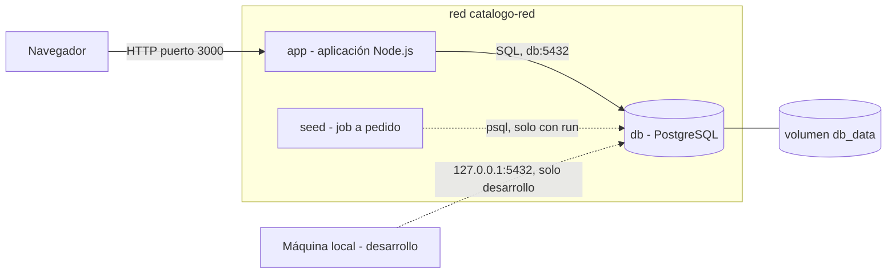
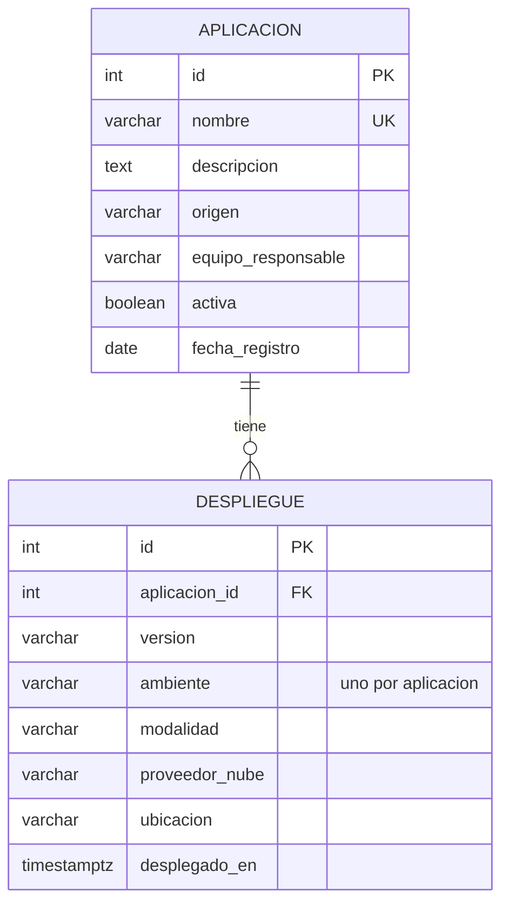
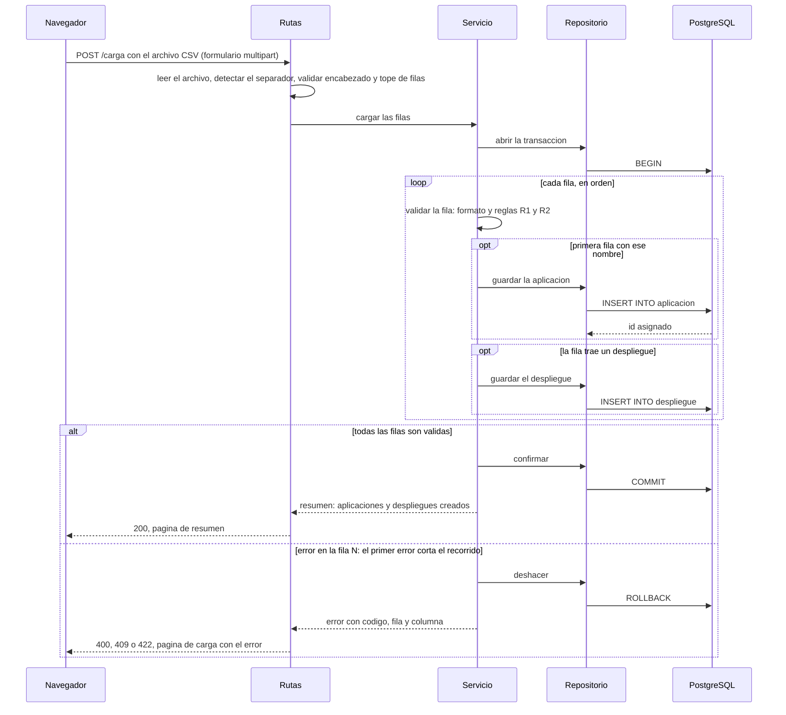

# Arquitectura

Este documento describe, a grandes rasgos, cómo está construida la solución. Los detalles y el porqué de cada decisión están en [docs/adr/](adr/README.md).

## 1. Propósito y alcance

Un catálogo de aplicaciones de una organización: qué aplicaciones existen, de quién son y dónde están desplegadas (en qué ambiente, versión y modalidad).

El foco del trabajo es la **contenerización**. La aplicación es un **monolito en Node.js** que arma las páginas en el servidor: un solo proceso sirve la interfaz, aplica las reglas y habla con la base de datos. Es deliberadamente pequeña y no se sobrediseña: separar la interfaz y la lógica en dos servicios agregaría piezas sin beneficio para este alcance ([ADR-0003](adr/0003-aplicacion-monolitica-en-capas.md)). Aun así está ordenada para que se vean las decisiones de arquitectura: separación en capas, manejo uniforme de errores y arranque ordenado de los contenedores.

**Alcance:** crear y consultar aplicaciones y sus despliegues, de a uno por formulario o varias a la vez con un archivo CSV. No se edita ni se elimina.

**Fuera de alcance** (decisiones conscientes, no olvidos): autenticación y autorización, paginación, caché, HTTPS, CI/CD y orquestación con Kubernetes.

## 2. Vista de contenedores



- Cada componente corre en **un contenedor con un solo proceso principal**.
- **El navegador solo habla con `app`**, en el puerto 3000. `app` arma las páginas completas en el servidor y las devuelve listas. No hay API de datos: `/health` es la única ruta técnica y responde en JSON.
- La imagen de `app` es el servidor web de la aplicación: Node.js atiende HTTP en el puerto 3000.
- Los tres servicios están en la red **`catalogo-red`** y se encuentran por el nombre del servicio: `app` se conecta a `db` en `db:5432`.
- `db` publica el 5432 **solo en `127.0.0.1`** (arista punteada desde la máquina local). Sirve para desarrollar la aplicación sin contenedor o para conectarse con un cliente SQL; no se alcanza desde otras máquinas.
- `seed` (arista punteada) no forma parte del arranque: es un job **a pedido** que solo corre con `docker compose run --rm seed`. Carga los datos base y su contenedor se borra al terminar.
- Los datos de `db` viven en el volumen `db_data`, fuera del contenedor.

## 3. Servicios y su orden de arranque

| Servicio | Imagen | Depende de | Condición |
|---|---|---|---|
| `db` | `catalogo-db:1.0` (propia, sobre `postgres:17-alpine`) | nada | n/a |
| `seed` (perfil `seed`) | `postgres:17-alpine` | `db` | `service_healthy` |
| `app` | `catalogo-app:1.0` (propia, sobre `node:24-alpine`) | `db` | `service_healthy` |

`db` declara un `healthcheck` con `pg_isready`, consultando por TCP a propósito (ver [ADR-0007](adr/0007-arranque-ordenado-y-seed.md)). Compose no arranca `app` hasta que la base de datos responde, así que **la aplicación no necesita lógica de reintentos al arrancar**. Si la base de datos se cae con la aplicación ya en ejecución, la aplicación responde `503` con su página de error (ver [errores.md](errores.md)).

`app` también declara un `healthcheck`, que consulta su propio `/health`: aparece *healthy* cuando la aplicación responde y llega a la base, y *unhealthy* si la base no está disponible. Ningún servicio depende de él; sirve para ver el estado real en `docker compose ps` y para que `docker compose up --wait` espere a que la aplicación atienda.

`seed` pertenece al perfil `seed`: `docker compose up` **no** lo ejecuta. Se lanza a pedido con `docker compose run --rm seed`, que levanta `db` si hace falta y espera la misma condición `service_healthy`. `app` no depende de él.

## 4. Capas de la aplicación

```text
Navegador  ->  Rutas  ->  Servicios  ->  Repositorios  ->  PostgreSQL
                 |       (negocio)        (SQL)
                 v
              Vistas (plantillas)  ->  página HTML
```

Las dependencias van en un solo sentido: las rutas usan los servicios y las vistas; los servicios usan los repositorios; los repositorios solo hablan con la base.

El punto de entrada es `app/src/index.js`: lee la configuración, monta las rutas y los archivos estáticos, responde `/health`, muestra la página 404 y hace el apagado ordenado. Las plantillas usan EJS. Los archivos de cada capa, dentro de `app/src/`, son:

| Capa | Archivos |
|---|---|
| Vistas | `views/lista.ejs` (lista y búsqueda), `views/detalle.ejs` (detalle, despliegues y formulario de despliegue), `views/nueva.ejs` (alta de aplicación), `views/carga.ejs` (carga del CSV) y `views/error.ejs` (página de error, incluida la 404). Los estilos están en `public/css/estilos.css` |
| Rutas | `routes/aplicaciones.js` (`/aplicaciones`: lista, detalle, alta de aplicación y alta de despliegue) y `routes/carga.js` (`/carga`: recibe el archivo) |
| Servicios | `services/aplicaciones.js` y `services/despliegues.js` (altas y consultas); para la carga del CSV, `services/lector-csv.js` (lectura, separador, encabezado y tope de filas), `services/agrupar-csv.js` (agrupa las filas por aplicación), `services/validador-csv.js` (validación de cada aplicación y despliegue) y `services/importacion.js` (guarda todo en una transacción) |
| Repositorios | `repositories/conexion.js` (el pool de `pg`), `repositories/aplicaciones.js` y `repositories/despliegues.js` (consultas SQL) |

La responsabilidad de cada capa:

| Capa | Carpeta | Responsabilidad | No debe |
|---|---|---|---|
| Vistas | `app/src/views` | Armar la página HTML con los datos que reciben | Contener reglas de negocio ni SQL |
| Rutas (controladores) | `app/src/routes` | Recibir la petición, el formulario o el archivo; validar el formato; llamar al servicio; elegir qué página mostrar y con qué código HTTP | Contener reglas de negocio ni SQL |
| Servicios | `app/src/services` | Reglas de negocio (R1 y R2), orden de las validaciones, transacciones (incluida la carga del CSV) y traducción de los errores de la base de datos | Conocer HTTP ni las vistas |
| Repositorios | `app/src/repositories` | Consultas SQL y mapeo de filas a objetos | Decidir reglas de negocio |
| Base de datos | `db/schema.sql` | Última línea de defensa: `CHECK`, `FOREIGN KEY`, `UNIQUE`, `NOT NULL` | Ser la única validación |

**Dónde vive cada validación**

| Validación | Capa | HTTP (se muestra en la página) |
|---|---|---|
| Campo faltante, valor fuera de la lista, texto demasiado largo, id no numérico | Rutas | 400 |
| Archivo ausente, vacío o que no es CSV; encabezado incorrecto | Rutas | 400 |
| El archivo trae más filas que `MAX_FILAS_CSV` | Rutas | 413 |
| Una fila del CSV con un valor inválido | Servicio (la misma validación del alta individual) | 400, con la fila |
| La aplicación no existe | Servicio | 404 |
| `NUBE` exige `proveedor_nube`; las demás modalidades no lo admiten | Servicio (y `CHECK` en BD) | 422 |
| Nombre de aplicación repetido | `UNIQUE` en BD, traducido por el servicio | 409 |
| Ambiente repetido para la misma aplicación (alta o carga del CSV) | `UNIQUE (aplicacion_id, ambiente)` en BD, traducido por el servicio | 409 |

Las páginas y los formularios están en las rutas `routes/aplicaciones.js` y `routes/carga.js` y en las vistas de la tabla de archivos de arriba.

## 5. Modelo de datos



Una aplicación tiene de cero a muchos despliegues. Si se elimina la aplicación, se eliminan sus despliegues (`ON DELETE CASCADE`).

Un despliegue es el **estado actual**: la versión que hoy está en un ambiente, y `desplegado_en` indica desde cuándo. Hay como máximo uno por aplicación y ambiente (restricción `uq_despliegue_aplicacion_ambiente`), es decir, de 0 a 3 por aplicación. No se guarda historial ([ADR-0004](adr/0004-modelo-de-datos-del-catalogo.md)). El alcance es crear y consultar: un despliegue se crea y no se edita. El esquema completo, con sus restricciones, está en [`db/schema.sql`](../db/schema.sql).

Valores permitidos: `origen` (`PROPIA`, `PROVEEDOR`), `ambiente` (`DEV`, `QA`, `PROD`), `modalidad` (`ON_PREMISE`, `NUBE`, `SAAS`) y `proveedor_nube` (`AWS`, `AZURE`, `GCP`, `OTRO`).

## 6. Flujo principal: carga de un archivo CSV



- Las filas con el mismo `nombre` son la misma aplicación: se guarda con la primera y las siguientes solo agregan despliegues.
- **Todo o nada.** Si cualquier fila falla, se hace `ROLLBACK`: no se guarda nada y la página de carga indica la fila (con el encabezado como fila 1) y la columna del primer error. Las filas siguientes no se evalúan.
- Si el problema es del archivo completo (ausente, vacío, encabezado incorrecto o más filas que `MAX_FILAS_CSV`), las rutas responden `400` o `413` sin abrir la transacción.

El formato del archivo está en [docs/datos/README.md](datos/README.md) y en el [ADR-0006](adr/0006-carga-masiva-csv.md); el orden de validación, en [errores.md](errores.md#6-orden-de-las-validaciones).

## 7. Contenerización

**Imagen de la base de datos.** `db/Dockerfile` parte de `postgres:17-alpine` y copia `schema.sql` a `/docker-entrypoint-initdb.d/`. PostgreSQL ejecuta esos scripts **solo la primera vez que arranca con el directorio de datos vacío**. Consecuencias:

- Si se cambia `schema.sql`, hay que recrear el volumen para verlo: `docker compose down -v`.
- Si el script falla y el contenedor se reinicia, los scripts no se vuelven a ejecutar sobre un volumen que ya se inicializó.

**Imagen de la aplicación.** `app/Dockerfile` parte de `node:24-alpine` y se construye en dos etapas: la primera instala solo las dependencias de producción y la final copia esas dependencias y el código. Corre con el usuario sin privilegios `node`, expone el 3000 y arranca con `node src/index.js` en forma *exec*. En Compose, `app` lleva `init: true`, así que `docker stop` le hace llegar la señal de apagado y la aplicación se cierra al instante.

**Persistencia.** Los datos viven en el volumen nombrado `db_data`, montado en `/var/lib/postgresql/data`. Sobreviven a `docker compose down` y al borrado del contenedor, pero no a `docker compose down -v`. (Con PostgreSQL 18 o superior cambia la ruta de montaje; ver [ADR-0008](adr/0008-persistencia-con-volumen.md).)

**Seed.** Es un job a pedido del perfil `seed`: `docker compose up` no lo ejecuta. Se lanza con `docker compose run --rm seed`, corre `db/seed/seed.sql` y su contenedor se borra al terminar. Es idempotente: ejecutarlo varias veces no duplica datos. Sirve para desarrollo local; en el video la base arranca vacía.

**La red.** Compose crea la red `catalogo-red` (con nombre explícito, así se reconoce en `docker network ls`) y conecta a ella `db`, `seed` y `app`. Dentro de la red, cada servicio se encuentra por su nombre: por eso `app` usa `DB_HOST=db` y el puerto interno 5432. `docker compose down` elimina la red y `up` la vuelve a crear; los datos no se pierden porque están en el volumen.

**Variables de entorno.**

| Variable | Usada por | Por defecto | Descripción |
|---|---|---|---|
| `POSTGRES_USER`, `POSTGRES_PASSWORD`, `POSTGRES_DB` | `db`, `seed`, `app` | `catalogo`, `catalogo_dev`, `catalogo` | Credenciales y nombre de la base. Solo para desarrollo local |
| `DB_PORT` (en `.env`) | Compose (`db`) | `5432` | Puerto de la máquina (solo `127.0.0.1`) donde se publica la base |
| `APP_PORT` | Compose (`app`) | `3000` | Puerto de la máquina donde se publica la aplicación |
| `MAX_FILAS_CSV` | `app` | `100` | Máximo de filas de datos que acepta la carga de un CSV |
| `PORT` | `app` | `3000` | Puerto en el que escucha la aplicación dentro del contenedor (fijo en Compose) |
| `DB_HOST`, `DB_PORT`, `DB_NAME`, `DB_USER`, `DB_PASSWORD` | `app` | `db`, `5432`, derivadas de las `POSTGRES_*` | Conexión a la base de datos. `DB_HOST` y `DB_PORT` son fijos: es la dirección de `db` dentro de la red |

`DB_PORT` tiene dos usos: en `.env` es el puerto de la máquina donde se publica `db`; dentro del contenedor `app`, Compose lo fija en 5432, el puerto de `db` en la red. Cuando la aplicación corre en la máquina, sin contenedor, toma los valores por defecto definidos en su código: la conexión en [`app/src/repositories/conexion.js`](../app/src/repositories/conexion.js) (`localhost`, `5432`, base y usuario `catalogo`, contraseña `catalogo_dev`) y el puerto en [`app/src/index.js`](../app/src/index.js) (`3000`). Coinciden con los de [`.env.example`](../.env.example).

## 8. Decisiones registradas

| ADR | Decisión |
|---|---|
| [0001](adr/0001-docker-y-compose.md) | Un contenedor por componente, orquestados con Docker Compose |
| [0002](adr/0002-postgresql-con-scripts-sql.md) | PostgreSQL con esquema en scripts SQL, sin ORM |
| [0003](adr/0003-aplicacion-monolitica-en-capas.md) | Aplicación monolítica en Node.js, organizada en capas |
| [0004](adr/0004-modelo-de-datos-del-catalogo.md) | Modelo de datos: aplicación y despliegue (1 a N) |
| [0005](adr/0005-contrato-de-errores.md) | Formato único de errores y mapeo a códigos HTTP |
| [0006](adr/0006-carga-masiva-csv.md) | Carga masiva con un archivo CSV, todo o nada |
| [0007](adr/0007-arranque-ordenado-y-seed.md) | Arranque ordenado con healthcheck y seed a pedido |
| [0008](adr/0008-persistencia-con-volumen.md) | Persistencia con volumen nombrado |
