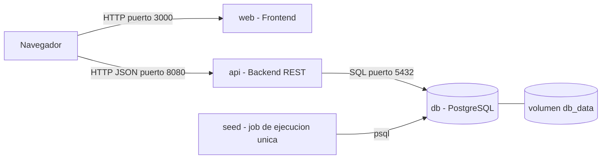
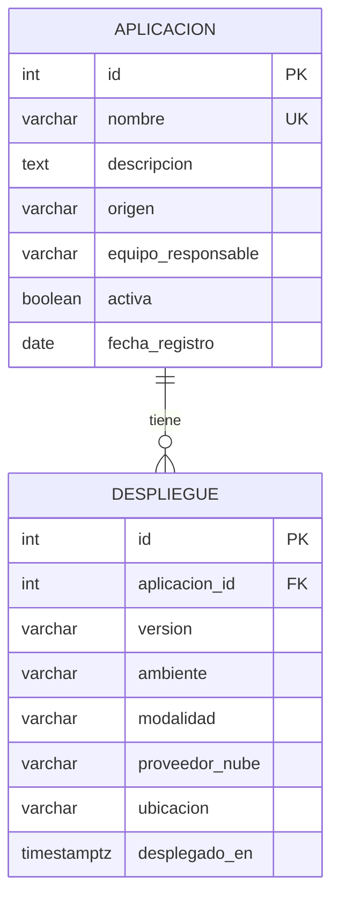
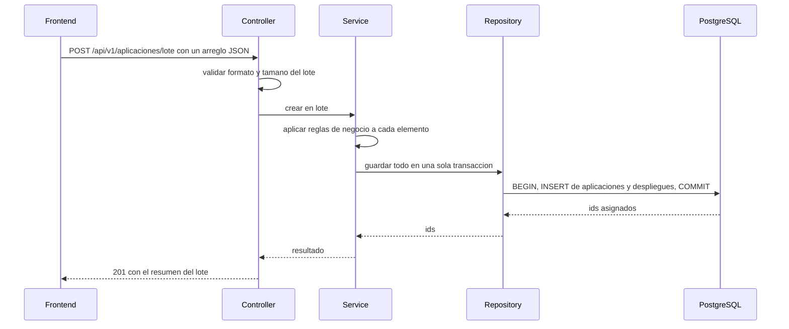

# Arquitectura

Este documento describe, a grandes rasgos, cómo está construida la solución. Los detalles y el porqué de cada decisión están en [docs/adr/](adr/README.md).

## 1. Propósito y alcance

Un catálogo de aplicaciones de una organización: qué aplicaciones existen, de quién son y dónde están desplegadas (en qué ambiente, versión y modalidad).

El foco del trabajo es la **contenerización**. El desarrollo es deliberadamente pequeño, pero estructurado de forma que se vean las decisiones de arquitectura: separación en capas, contrato de API, manejo uniforme de errores y arranque ordenado de los contenedores.

**Fuera de alcance** (decisiones conscientes, no olvidos): autenticación y autorización, paginación, caché, HTTPS, CI/CD y orquestación con Kubernetes.

## 2. Vista de contenedores



- Cada componente corre en **un contenedor con un solo proceso principal**.
- El navegador descarga la interfaz desde `web` y luego llama a la API directamente en el puerto 8080. Por eso la API habilita CORS para el origen de `web` (variable `CORS_ORIGIN`).
- Compose crea una red por defecto: los contenedores se encuentran por el nombre del servicio (`db`, `api`). Solo `api` y `seed` hablan con la base de datos.
- `seed` no es un servicio permanente: se ejecuta, carga los datos y termina.

## 3. Servicios y su orden de arranque

| Servicio | Imagen | Depende de | Condición |
|---|---|---|---|
| `db` | `catalogo-db:1.0` (propia, sobre `postgres:17-alpine`) | nada | n/a |
| `seed` | `postgres:17-alpine` | `db` | `service_healthy` |
| `api` | construida desde `backend/` | `db` | `service_healthy` |
| `web` | construida desde `frontend/` | `api` | `service_started` |

`db` declara un `healthcheck` con `pg_isready`, consultando por TCP a propósito (ver [ADR-0007](adr/0007-arranque-ordenado-y-seed.md)). Compose no arranca `seed` ni `api` hasta que la base de datos responde, así que **la API no necesita lógica de reintentos al arrancar**. Si la base de datos se cae con la API ya en ejecución, la API responde `503` (ver [errores.md](errores.md)).

## 4. Capas del backend

```text
Controller  ->  Service  ->  Repository  ->  PostgreSQL
 (HTTP)        (negocio)     (datos)
```

| Capa | Responsabilidad | No debe |
|---|---|---|
| Controller | Rutas, lectura del JSON, validación de formato (obligatorios, tipos, valores permitidos), traducir errores a respuestas HTTP | Contener reglas de negocio ni SQL |
| Service | Reglas de negocio, orden de validaciones, transacciones (incluida la carga masiva) | Conocer HTTP |
| Repository | Consultas SQL y mapeo a objetos | Decidir reglas de negocio |
| Base de datos | Última línea de defensa: `CHECK`, `FOREIGN KEY`, `UNIQUE`, `NOT NULL` | Ser la única validación |

**Dónde vive cada validación**

| Validación | Capa | Respuesta |
|---|---|---|
| JSON malformado, campo faltante, tipo o valor inválido | Controller | 400 |
| La aplicación o el despliegue no existe | Service | 404 |
| `NUBE` exige `proveedor_nube`; las demás modalidades no lo admiten | Service (y `CHECK` en BD) | 422 |
| `SAAS` solo para aplicaciones de origen `PROVEEDOR` | Service (involucra dos tablas, no puede ser un `CHECK`) | 422 |
| Nombre de aplicación repetido | `UNIQUE` en BD, traducido por el Service | 409 |
| Lote vacío o mayor que `MAX_BATCH_SIZE` | Controller | 400 / 413 |

## 5. Modelo de datos



Una aplicación tiene de cero a muchos despliegues. Si se elimina la aplicación, se eliminan sus despliegues (`ON DELETE CASCADE`). El esquema completo, con sus restricciones, está en [`db/schema.sql`](../db/schema.sql).

Valores permitidos: `origen` (`PROPIA`, `PROVEEDOR`), `ambiente` (`DEV`, `QA`, `PROD`), `modalidad` (`ON_PREMISE`, `NUBE`, `SAAS`) y `proveedor_nube` (`AWS`, `AZURE`, `GCP`, `OTRO`).

## 6. Flujo principal: carga masiva



Si cualquier elemento falla, se hace `ROLLBACK`: no se guarda nada y el error indica la posición (`indice`) del primer elemento con problema.

## 7. Contenerización

**Imagen de la base de datos.** `db/Dockerfile` parte de `postgres:17-alpine` y copia `schema.sql` a `/docker-entrypoint-initdb.d/`. PostgreSQL ejecuta esos scripts **solo la primera vez que arranca con el directorio de datos vacío**. Consecuencias:

- Si se cambia `schema.sql`, hay que recrear el volumen para verlo: `docker compose down -v`.
- Si el script falla y el contenedor se reinicia, los scripts no se vuelven a ejecutar sobre un volumen que ya se inicializó.

**Persistencia.** Los datos viven en el volumen nombrado `db_data`, montado en `/var/lib/postgresql/data`. Sobreviven a `docker compose down` y al borrado del contenedor, pero no a `docker compose down -v`. (Con PostgreSQL 18 o superior cambia la ruta de montaje; ver [ADR-0008](adr/0008-persistencia-con-volumen.md).)

**Seed.** Es un contenedor de ejecución única (`restart: "no"`) que corre `db/seed/seed.sql`. Es idempotente: ejecutarlo varias veces no duplica datos.

**Variables de entorno.**

| Variable | Usada por | Por defecto | Descripción |
|---|---|---|---|
| `POSTGRES_USER`, `POSTGRES_PASSWORD`, `POSTGRES_DB` | `db`, `seed`, `api` | `catalogo`, `catalogo_dev`, `catalogo` | Credenciales y nombre de la base. Solo para desarrollo local |
| `DB_HOST`, `DB_PORT`, `DB_NAME`, `DB_USER`, `DB_PASSWORD` | `api` | `db`, `5432`, derivadas de las anteriores | Conexión a la base de datos |
| `PORT` | `api` | `8080` | Puerto en el que escucha la API dentro del contenedor |
| `MAX_BATCH_SIZE` | `api` | `100` | Tope de aplicaciones por carga masiva |
| `CORS_ORIGIN` | `api` | `http://localhost:3000` | Origen del frontend permitido |
| `API_BASE_URL` | `web` | `http://localhost:8080` | URL de la API que usa el navegador |

## 8. Decisiones registradas

| ADR | Decisión |
|---|---|
| [0001](adr/0001-docker-y-compose.md) | Un contenedor por componente, orquestados con Docker Compose |
| [0002](adr/0002-postgresql-con-scripts-sql.md) | PostgreSQL con esquema en scripts SQL, sin ORM |
| [0003](adr/0003-backend-en-capas-y-rest.md) | Backend en capas con API REST y contrato primero |
| [0004](adr/0004-modelo-de-datos-del-catalogo.md) | Modelo de datos: aplicación y despliegue (1 a N) |
| [0005](adr/0005-contrato-de-errores.md) | Formato único de errores y mapeo a códigos HTTP |
| [0006](adr/0006-carga-masiva-json.md) | Carga masiva con JSON, todo o nada y tope configurable |
| [0007](adr/0007-arranque-ordenado-y-seed.md) | Arranque ordenado con healthcheck y seed como job único |
| [0008](adr/0008-persistencia-con-volumen.md) | Persistencia con volumen nombrado |
| [0009](adr/0009-stack-del-backend.md) | Lenguaje y framework del backend (pendiente) |
| [0010](adr/0010-stack-del-frontend.md) | Framework del frontend (pendiente) |
